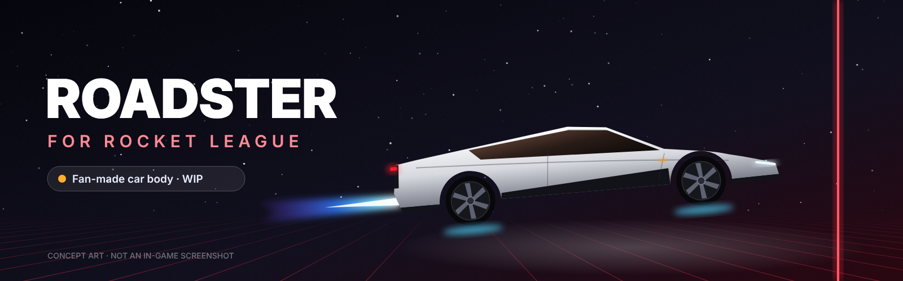
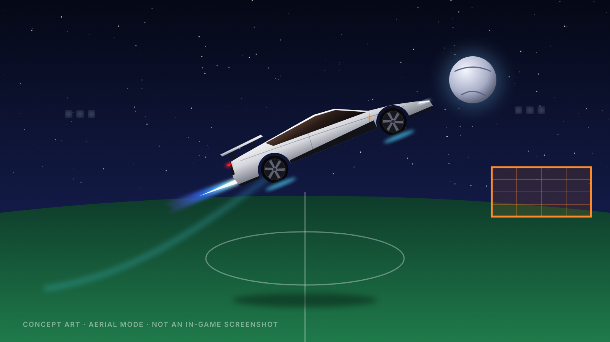
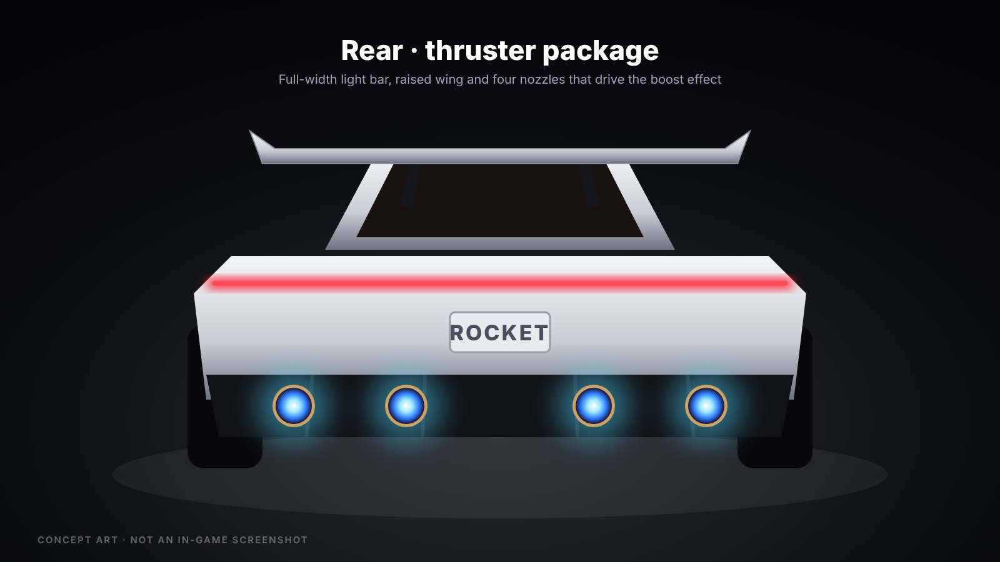
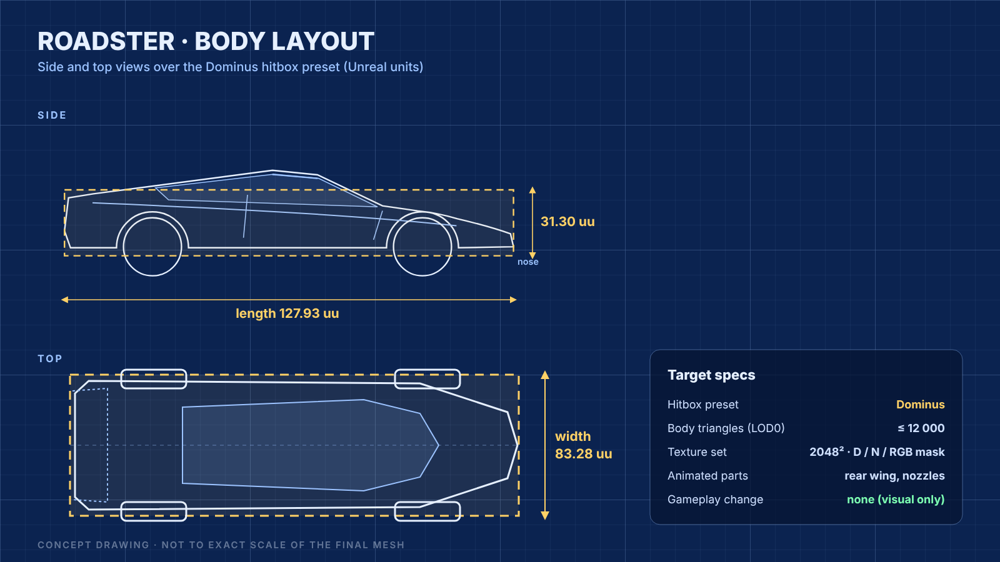
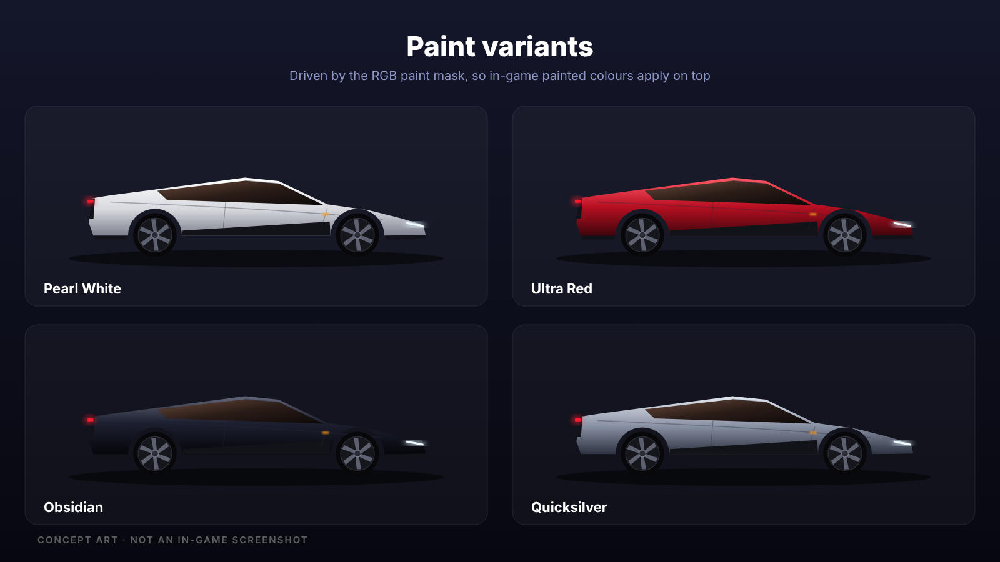

<div align="center">



# Roadster для Rocket League

**Фанатская модель летающего родстера для Rocket League. Работает только у тебя на клиенте и меняет только внешний вид.**

[](#-планы)
[](CHANGELOG.md)
[](docs/INSTALL.md)
[](LICENSE)

[English](README.md) · **Русский**

</div>

---

> [!IMPORTANT]
> **Проект на ранней стадии. Готовой сборки для игры пока нет.**
> Картинки ниже — **концепт-арты**, а не скриншоты из игры. Как только первая сборка заработает в игре, их заменят настоящие скриншоты. Поставь ⭐ или Watch, чтобы не пропустить.

> [!WARNING]
> Скачивай сборки только со страницы **[Releases](../../releases)** этого репозитория. Мод — это один файл `.upk` и PowerShell-скрипты, которые можно прочитать. Он **никогда** не распространяется в виде `.exe`. Если тебе прислали «установщик Roadster mod» в `.exe`, не запускай его. Подробнее в [SECURITY.md](SECURITY.md).

## ✨ Что это

**Roadster** заменяет внешний вид машины в Rocket League на фанатскую копию **нового электрического Roadster**: острый клиновидный нос, длинный стеклянный купол, красная световая полоса во всю ширину, заднее крыло и четыре сопла сзади, благодаря которым он «летает». В Rocket League летают все машины, а эта ещё и выглядит так, будто для этого создана.

- 🏎️ **Новый кузов.** Низкий длинный силуэт, кабина в духе открытого родстера и светящиеся парящие пластины снизу.
- 🎨 **Окрашивается.** RGB-маска покраски, так что твои основной и акцентный цвета из игры работают.
- 🔥 **Сопла вместо буста.** Буст выходит из четырёх сопел в заднем диффузоре.
- 🪽 **Заднее крыло.** Большое крыло поднимается в воздухе (анимация в планах).
- 📦 **Хитбокс Dominus.** Модель построена вокруг существующего хитбокса, поэтому геймплей не меняется.
- 👁️ **Только у тебя.** Родстер видишь только ты, соперники видят твою обычную машину.
- ♻️ **Обратимо.** Установщик делает резервную копию оригинала, и одна команда всё возвращает.

## 🖼️ Концепт-арты

> [!NOTE]
> Это рисунки-концепты для проекта, **не скриншоты из игры.**

<div align="center">



<sub><b>В воздухе.</b> Сопло буста, парящие пластины и целевой силуэт.</sub>

<br><br>



<sub><b>Корма с соплами.</b> Красная полоса во всю ширину, поднятое крыло и четыре сопла буста.</sub>

<br><br>

<table>
  <tr>
    <td width="50%"></td>
    <td width="50%"></td>
  </tr>
  <tr>
    <td align="center"><sub><b>Компоновка кузова</b> поверх хитбокса Dominus</sub></td>
    <td align="center"><sub><b>Варианты окраски</b> через RGB-маску</sub></td>
  </tr>
</table>

</div>

## 📊 Характеристики

| | Цель |
|---|---|
| **Хитбокс** | Dominus · 127.93 × 83.28 × 31.30 uu |
| **Модель кузова (LOD0)** | ≤ 12 000 треугольников |
| **Текстуры** | 2048² Diffuse · Normal · RGB-маска покраски |
| **Колёса** | Твои надетые колёса |
| **Изменения геймплея** | Нет (только внешний вид) |
| **Платформа** | Windows PC (Epic Games и Steam) |

## 🚀 Установка

> [!CAUTION]
> Изменение файлов игры — **на твой страх и риск**. Используй мод в **офлайн-режимах, Free Play и приватных матчах**. Обновление игры или кнопка **«Проверить»** в лаунчере вернут оригинальный файл.

Когда выйдет релиз:

1. Скачай `Body_Roadster_SF.upk` со страницы **[Releases](../../releases)** и положи его в папку `dist/`.
2. **Закрой Rocket League.**
3. Открой PowerShell в папке репозитория и выполни:

   ```powershell
   powershell -ExecutionPolicy Bypass -File scripts\install.ps1
   ```

   Если игра стоит в нестандартной папке, укажи путь:

   ```powershell
   powershell -ExecutionPolicy Bypass -File scripts\install.ps1 -GamePath "D:\Games\rocketleague"
   ```

4. Запусти игру, зайди в **Гараж** и выбери кузов **Dominus**.

**Удаление:**

```powershell
powershell -ExecutionPolicy Bypass -File scripts\uninstall.ps1
```

Полная инструкция: **[docs/INSTALL.md](docs/INSTALL.md)**.

## 🛠️ Сборка из исходников

```
Blender (.blend) ──► экспорт FBX ──► check_model.py ──► импорт в UDK и материалы ──► .upk ──► dist/
```

Перед импортом в UDK проверь модель на соответствие хитбоксу:

```bash
python scripts/check_model.py exports/roadster.obj
```

Весь процесс описан в **[docs/BUILDING.md](docs/BUILDING.md)**.

## 🗺️ Планы

- [x] Концепт-арты и целевые характеристики
- [x] Репозиторий, манифест, установщик и удаление с резервной копией
- [x] Проверка модели (`check_model.py`) и CI
- [ ] Черновая модель в Blender в масштабе хитбокса
- [ ] Хай-поли скульпт и запекание
- [ ] Игровая модель LOD0 (≤ 12k треугольников) и развёртка
- [ ] Текстуры: Diffuse / Normal / RGB-маска
- [ ] Первая тестовая сборка в игре 🎯 **здесь появятся настоящие скриншоты**
- [ ] Буст из четырёх сопел, анимация крыла, свечение пластин
- [ ] Развёртка под декали
- [ ] Релиз `v1.0.0`

## 🤝 Как помочь

Нужны 3D-художники, текстурщики и те, кто знает UE3/UDK. Начни с **[CONTRIBUTING.md](CONTRIBUTING.md)** и открой issue, чтобы рассказать, чем хочешь заняться.

## ❓ Вопросы

<details>
<summary><b>Могут ли за это забанить?</b></summary>
<br>
Мод меняет только локальный файл с графикой и не трогает геймплей, память или сеть. Но изменение файлов игры официально не поддерживается Psyonix и Epic Games, поэтому используй его на свой риск, лучше офлайн. Подробнее в <a href="docs/FAQ.md">docs/FAQ.md</a>.
</details>

<details>
<summary><b>Другие игроки увидят мой Roadster?</b></summary>
<br>
Нет. Всё работает только у тебя. Остальные видят машину, которая у тебя реально надета.
</details>

<details>
<summary><b>Работает на PlayStation, Xbox, Switch или Mac?</b></summary>
<br>
Нет, только ПК на Windows: на консолях файлы игры менять нельзя.
</details>

<details>
<summary><b>Это официальная модель Tesla?</b></summary>
<br>
Нет. Это фанатская модель, воссозданная вручную по публичным фото нового Tesla Roadster. Официальные чертежи не используются, логотипов и шильдиков Tesla на модели нет. Референсы собраны в <a href="docs/REFERENCES.md">docs/REFERENCES.md</a>.
</details>

## ⚖️ Отказ от ответственности

Это неофициальный фанатский проект. Он **не связан** с Psyonix, Epic Games и Tesla, Inc. и не одобрен ими. *Rocket League* — товарный знак Psyonix LLC. Остальные товарные знаки принадлежат их владельцам. Код репозитория распространяется по [лицензии MIT](LICENSE). Файлы игры здесь не распространяются.

<div align="center">
<br>
<sub>Сделано фанатами с 🚀 Если идея нравится, поставь ⭐</sub>
</div>
